[LinkedIn](https://www.linkedin.com/in/raghav-khedar-009406251/) &nbsp;·&nbsp; [Instagram](https://www.instagram.com/khedar._/) &nbsp;·&nbsp; [Discord](https://discordapp.com/users/fliper0005) &nbsp;·&nbsp; [Email](mailto:raghavkhedar528@gmail.com)

